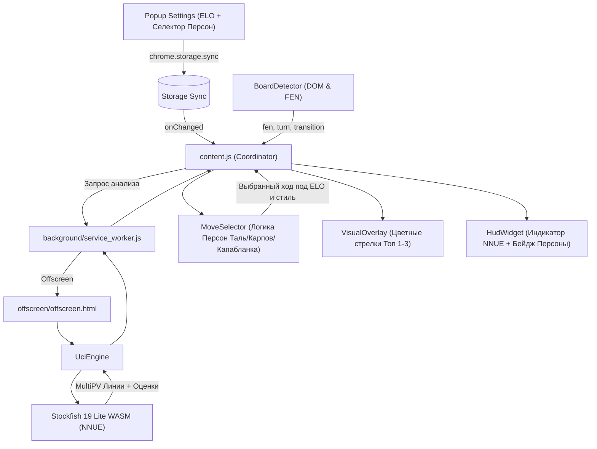

# 📋 План развития Chess Sensei: Stockfish NNUE (WASM) и AI Personas

Документ описывает архитектурный план и техническую спецификацию для реализации двух ключевых возможностей:
1. **Апгрейд встроенного движка до Stockfish 19 Lite WASM с нейросетью NNUE.**
2. **Внедрение 4 шахматных стилей игры (AI Personas: Таль, Карпов, Капабланка, Баланс).**

---

## 1. ⚡ Апгрейд движка: Stockfish 19 Lite WASM + NNUE

### 1.1. Текущее состояние
В версии 1.0.2 встроенный JavaScript-движок представляет собой бинарник Stockfish 2019 года на `asm.js` без нейросетевой оценки (классическая математическая оценка материала и позиционных таблиц).

### 1.2. Целевая архитектура
* **Движок:** Stockfish 19 Lite WASM (официальная сборка WebAssembly от команды Stockfish / nmrugg).
* **Нейросеть (NNUE):** Встроена непосредственно в WASM-бинарник (`nn-61e7af4bb97d.nnue`, около 1 МиБ; весь WASM — 1 787 571 байт).
* **Автономность:** 100% локальная работа. Не требуется скачивать отдельные файлы весов по 40 МБ.
* **Потоковая модель:** Однопоточный WebAssembly Worker в Manifest V3 Offscreen Document. Не требует заголовков изоляции CORS (`COOP`/`COEP`), работает стабильно во всех браузерах (Chrome, Edge, Brave, Yandex).
* **Производительность:**
  * Целевой ориентир: глубина 8–10 за **40–80 мс** на современном компьютере. Проверяется замерами, зависит от позиции и MultiPV.
  * Сила Lite отличается от полной сборки Stockfish. ELO профиля не является замером силы; гарантированный рейтинг 3200+ не заявляется.
* **Фоллбэк:** Если браузерная среда не поддерживает WebAssembly или при сбое, происходит мягкий откат на классический JS или Python Bridge.

---

## 2. 🎭 Шахматные стили игры (AI Personas)

В дополнение к регулировке ELO и Blunder Filter внедряется система шахматных архетипов:

### 2.1. Описание персон

| Персона | Иконка | Стиль | Поведение и приоритеты алгоритма |
| :--- | :---: | :--- | :--- |
| **Михаил Таль** | ⚔️ | *Атакующий / Романтический* | Приоритет шахам, тактическим ударам, взятиям, жертвам пешек за инициативу и форсированному вскрытию линий. В пределах допустимой безопасной потери выбирает самый острый ход. |
| **Анатолий Карпов** | 🛡️ | *Позиционный / Защитный* | Приоритет гармоничному развитию легких фигур, укреплению пешечной структуры, централизации, профилактике угроз соперника и удушению его контригры. |
| **Хосе Капабланка** | 👑 | *Эндшпильный / Классический* | При наличии перевеса форсирует размен ферзей и переход в чистый выигранный эндшпиль. В эндшпиле активизирует короля и проводит проходные пешки. |
| **Стандарт** | ⚡ | *Сбалансированный* | Классическая игра по весам ELO и стратегии «Сноубол» (Smooth Snowballing). |

### 2.2. Алгоритм модификации весов (Persona Scoring Modifier)
Для каждого хода-кандидата из MultiPV (Топ 1–3), прошедшего Blunder Filter (потеря $\le 160$ cp):
1. **Анализ характеристик хода через `chess.js`:**
   * Дает ли ход шах? (`isCheck`)
   * Является ли ход взятием? (`isCapture`)
   * Происходит ли размен ферзей? (`isQueenTrade`)
   * Развивает ли ход легкую фигуру (конь/слон)? (`isMinorDev`)
   * Активизирует ли короля в эндшпиле? (`isKingActive`)
2. **Коррекция вероятности (Weight Bias):**
   * **Таль:** `+35%` к вероятности за шахи и взятия.
   * **Карпов:** `+30%` к вероятности за развитие и укрепление структуры, `-25%` штраф за ранние рискованные вылазки ферзя.
   * **Капабланка:** `+40%` к вероятности за размен ферзей при оценке $\ge +1.0$ пешки (100 cp).
3. **Строгая безопасность:** Blunder Filter остаётся активным для всех персон — откровенные зевки никогда не рекомендуются.

---

## 3. 🏛️ Схема взаимодействия модулей



---

## 4. 📁 Список файлов и планируемые изменения

### Модули движка и Offscreen
1. **`offscreen/stockfish-nnue.js`** *(новый)*: скрипт-обертка WebAssembly для Stockfish 19.
2. **`offscreen/stockfish-nnue.wasm`** *(новый, 1.78 МБ)*: оптимизированный бинарник Stockfish 19 со встроенной сетью `nn-61e7af4bb97d`.
3. **`offscreen/offscreen.js`**: инициализация `UciEngine` с приоритетом WASM NNUE и мягким фоллбэком.
4. **`manifest.json`**: добавление `.wasm` и `.js` файлов в `web_accessible_resources`.

### Логика персон и контроллер
5. **`engine/move_selector.js`**: реализация структуры `PERSONAS`, анализ тактических свойств ходов через `chess.js`, пересчет весов вероятностей.
6. **`engine/engine_controller.js`**: передача объекта позиции и выбранной персоны в `MoveSelector`.

### Пользовательский интерфейс (UI)
7. **`popup/popup.html` & `popup/popup.css`**: блок выбора стиля игры с 4 кнопками (`⚡ Баланс`, `⚔️ Таль`, `🛡️ Карпов`, `👑 Капабланка`) и описанием.
8. **`popup/popup.js`**: реактивное сохранение `aiPersona` в `chrome.storage.sync`.
9. **`content/hud_widget.js` & `content/styles.css`**: бейдж текущей персоны в HUD, неоновый индикатор `🧠 NNUE (WASM)`.
10. **`content/content.js`**: синхронизация персоны без перезагрузки вкладки.

### Тестирование
11. **`test/run_tests.js`**: расширение юнит-тестов (проверка смещения вероятностей для всех персон, проверка отсева зевов у Таля).
12. **`test/regression_tests.js`**: проверка работы Stockfish WASM в Node / Worker.

---

## 5. 🧪 План верификации

### Автоматические тесты
```bash
node test/run_tests.js
node test/regression_tests.js
python test/test_bridge.py
```

### Ручные сценарии проверки
1. **Проверка на тестовом стенде (`test/test_board.html`):**
   * Переключение персон: проверка, что при стиле «Таль» выбираются острые атакующие ходы, а при стиле «Капабланка» — размены в эндшпиль.
2. **Проверка движка NNUE:**
   * Открытие Offscreen Document в DevTools (`chrome://inspect/#other`).
   * Проверка лога: `Stockfish 19 Lite WASM` и `NNUE evaluation using nn-61e7af4bb97d.nnue`.
   * Контроль времени отклика: 40–80 мс на ход.

## 6. Реализация и уточнения — версия 1.1.0

- [x] Закреплён релиз nmrugg/stockfish.js v19.0.0: `stockfish-19-lite-single.js` и `.wasm`, переименованные в `offscreen/stockfish-nnue.*` без изменения содержимого.
- [x] Встроенная сеть `nn-61e7af4bb97d.nnue` подтверждается реальным UCI-выводом. WASM: 1 787 571 байт. GPLv3, источник и SHA-256 сохранены в `vendor/`.
- [x] Однопоточный Worker в Offscreen Document, без COOP/COEP и сетевого скачивания весов. Автономный стенд использует ту же цепочку.
- [x] Фоллбэк NNUE → классический JS при ошибке, неподдерживаемом WebAssembly и таймауте. Включённый Python Bridge по-прежнему имеет приоритет. Закрытие страницы не перезапускает движок через фоллбэк.
- [x] Четыре персоны с нормализацией неизвестных значений в `balanced`.
- [x] Через chess.js проверяются шах, взятие, развитие, структура, профилактика, активность короля, проходные и размен обеих ферзей по легальной PV. Для Таля дополнительно распознаётся пешечная жертва с шахом или взятием в продолжении.
- [x] Модификаторы относятся к весам до нормализации: Таль ×1.35, Карпов ×1.30 и штраф раннему ферзю ×0.75, Капабланка ×1.40 за размен при ≥100 cp и ×1.30 за короля/проходную. Итоговые вероятности суммируются в 1.
- [x] Фильтр ≤160 cp обязателен для всех персон; нельзя обойти настройкой, ручным выбором или Re-roll. Он оценивает потерю относительно лучшего кандидата, а не обещает выигрыш из проигранной позиции.
- [x] Селектор в popup, описание, бейдж и селектор в HUD, синхронизация `aiPersona` через storage.onChanged без перезагрузки.
- [x] Именные персоны получают MultiPV и в дебюте; Баланс сохраняет быстрый книжный ход. Трекер точности использует оптимальные оценки и не зависит от стилистического выбора.
- [x] Юнит-тесты смещений и безопасности, реальная NNUE в Node/Worker, браузерный NNUE и фоллбэк, установка расширения и двусторонняя синхронизация popup/HUD.

Дизайн: тёмный шахматный пульт; DFII 13 (4+4+4+4−3). Четыре компактные кнопки с характерными шахматными символами, Georgia для названий и Verdana для пояснений, текущая зелёная акцентная палитра в CSS-переменных. Клавиатурный фокус, aria-pressed и reduced-motion предусмотрены. Общая структура расширения сохранена.

Замеры на текущем компьютере: реальные поиски глубины 10 — приблизительно 27–114 мс (Node и Edge, конкретные тестовые позиции и разные запуски); время загрузки/компиляции не включено. Сила и время на других устройствах не гарантируются. Проверка браузеров выполнена в Edge; Lichess проверен на DOM-стенде.

Итог проверки: 72 основных проверки (включая 26 проверок персон), 40 регрессионных проверок с реальной NNUE, 2 Python-теста. Браузерные сценарии NNUE/JS, popup/HUD и Lichess DOM прошли в Edge.
